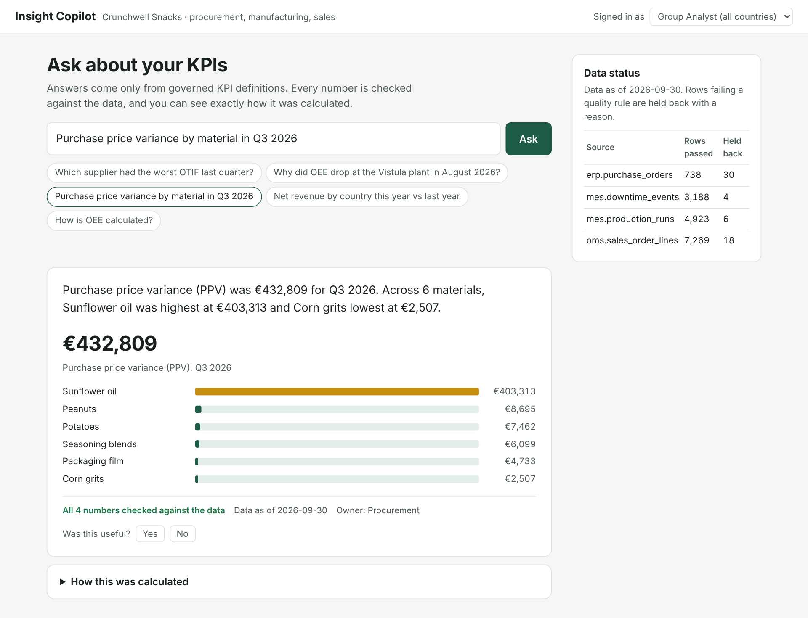
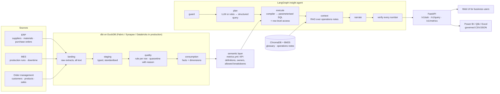

# FMCG Insight Copilot

[](https://github.com/manojrevenkar12-web/fmcg-insight-copilot/actions/workflows/ci.yml)

**AI-generated analytics that business users can trust: a layered data platform (landing → quality → consumption, built with dbt and SQL), a governed semantic layer of KPIs, and a LangGraph agent that answers questions in plain English. It never writes its own SQL, checks every number it says against the data, and shows how each number was calculated.**



The setting is a fictional snack manufacturer, *Crunchwell Snacks*, with three plants (DE, NL, PL) and data from three source systems: ERP procurement, MES manufacturing and order management. Business users in procurement, manufacturing and sales ask questions such as:

- *"Which supplier had the worst OTIF last quarter?"* — Baltic Agro, 42.9% against 83.7% overall.
- *"Why did OEE drop at the Vistula plant in August 2026?"* — 81.8% against 85.4% in July, with the maintenance note on line 2's gearbox failures cited as context.
- *"Net revenue by country this year vs last year"* — a breakdown and the biggest mover.
- *"How is OEE calculated?"* — the governed definition, formula and owner.

Each answer comes with the KPI definition and business owner, the SQL that ran (parameters bound separately), lineage from the consumption table back to the source extract, the data as-of date, the data-quality status of the sources used, and the result of the number check.

## Measured results

`python eval/run_eval.py` grades the copilot on 35 golden questions. Numbers are checked against **independent hand-written SQL**, not against the semantic layer, so a wrong KPI definition cannot grade itself. The release gates run in CI.

| Gate (golden set, offline mode) | Result |
|---|---|
| Correct plan (metric, breakdown, filters, period, comparison) | **35/35** |
| Headline number equal to independent SQL | **28/28** answered metric questions |
| Correct outcome (answered / declined / access restricted) | **35/35** |
| Answers whose every number passed verification | **100%** |
| Data shown outside the user's access rights | **0** |
| Prompt-injection and SQL-injection attempts flagged | **3/3** — none changed the data access or the query |

**Held-out set — the honest number.** The rule-based planner was tuned on the golden set. To see how it handles new wording, 15 paraphrases were written afterwards and run once, without tuning ([`eval/RESULTS-heldout.md`](eval/RESULTS-heldout.md)):

| Held-out (15 questions, never tuned on) | Result |
|---|---|
| Fully correct | **6/15** |
| Declined instead of guessing (e.g. "least reliable supplier", "wastes the most product") | 6 |
| Answered with part of the request missing (a comparison or a ranking) | 3 |
| **Answered with a wrong number** | **0** |

The rule-based planner fails safely — it declines or answers a narrower question, and it never makes up a number — but it does not understand paraphrases. That is what the LLM planner (`LLM_MODE=live`) is for: it maps wording to the same catalog and goes through the same validation, access rules and number check. Run `LLM_MODE=live OPENAI_API_KEY=... python eval/run_eval.py --heldout` to score a real model against the same set. It is not reported here because no model was evaluated.

## Architecture



**Data supply chain.** Extracts land unchanged with a load manifest. Staging types and standardises them, so `eur` and `EUR` become the same currency instead of a rejected row. The quality layer applies one rule set per source and keeps every row, either as clean or quarantined with the reason (duplicate, missing supplier, negative quantity, unknown SKU, delivered in the future). A dbt test asserts that received rows = passed + quarantined for every source, so nothing disappears silently. On this extract, 58 of 16,176 rows are held back.

**Semantic layer.** [`semantic/metrics.yml`](semantic/metrics.yml) defines 16 KPIs (spend, PPV, OTIF, on-time rate, rejection rate, OEE, availability, scrap, output, unplanned and total downtime, net revenue, volume, promotion share, return rate, net price/kg), each with a formula, unit, good direction, business owner, synonyms and the breakdowns it allows. Ratio KPIs are aggregated from totals — OEE is good output ÷ ideal output, never an average of line OEEs, and a test proves the difference matters.

**Why the AI never writes SQL.** The planner, LLM or rules, outputs a structured query: metric names, breakdowns, filters and a period. The compiler accepts only catalog identifiers, binds every value as a parameter, validates filter values against the warehouse, and adds the user's row-level access filter. The warehouse connection is read-only with external file access disabled. A prompt injection can at most change *which governed KPI* is asked for, and the user is entitled to see that KPI anyway.

**Why every number is checked.** Values, deltas and rankings are computed in code and passed to the narrator as the only allowed facts. The verifier then parses every number in the text — from the template or from an LLM — and removes any sentence whose number cannot be traced to those facts. Numbers quoted from operations notes are allowed only in a sentence that cites the note. This stops a wrong number in an AI insight from setting off a chain of wrong decisions.

## AI security and governance

| Risk | Control | Tested |
|---|---|---|
| Prompt injection ("ignore your rules", fake roles) | Question sent as data inside `<question>` tags; structured output only; guard flags and logs the attempt; the answer says it was ignored | `test_live_path`, `test_guard`, eval `inj-*` |
| SQL injection | No generated SQL; catalog identifiers only; values bound as parameters; read-only connection without external access | `test_filter_values_are_bound_parameters_never_sql` |
| Data leakage across countries | Row-level access applied in the compiler for every query path (copilot and `/v1/query`); restricted users are told they lack access instead of being shown zeros | `test_row_level_access_*`, eval `rls-*` |
| Wrong or invented numbers | Number verifier; independent-SQL evaluation in CI | `test_verifier_*`, eval gates |
| Chain-reaction errors (bad plan → bad SQL → bad insight) | Plan validated against the catalog, with one LLM repair attempt and fallback to the rule planner; template narrative replaces an LLM answer that fails verification | `test_invalid_llm_plan_is_repaired_once`, `test_llm_outage_falls_back…` |
| Personal data sent to the model | Only the question, catalog names and aggregated results; no raw rows | design |
| EU AI Act / GDPR | Decision support with named human KPI owners, transparency panel, interaction log | see [docs/azure-fabric.md](docs/azure-fabric.md) |

**Technical KPIs for the AI itself** are recorded per interaction and served at `GET /v1/ai-kpis` (admin role): answer, decline and restricted rates, share of answers whose numbers all verified, corrected answers, guard flags, latency p50/p95 and helpfulness from user feedback. Prometheus metrics are at `/ops/prometheus`.

## Run it

```bash
pip install -e ".[dev]"
insight build                      # generate source extracts, dbt build (25 models, 33 data tests)
insight serve                      # http://127.0.0.1:8000 — web UI; API docs at /docs
insight ask "Which supplier had the worst OTIF last quarter?"
```

Or `docker build -t insight-copilot . && docker run -p 8000:8000 insight-copilot`.

Demo API keys (local only; in production identities come from Entra ID): `demo-analyst-key` (all countries), `demo-sales-nl-key` (NL only), `demo-plant-pl-key` (PL only), `demo-admin-key` (adds the AI-KPI dashboard).

```bash
curl -X POST localhost:8000/v1/query -H 'X-API-Key: demo-analyst-key' -H 'content-type: application/json' \
  -d '{"metrics":["oee","scrap_rate"],"dimensions":["plant"],"period":{"kind":"last_quarter"},"format":"csv"}'
```

**With an LLM:** `LLM_MODE=live OPENAI_API_KEY=... OPENAI_BASE_URL=<Azure OpenAI or Foundry endpoint> insight serve`.

## Tests

| Suite | Covers |
|---|---|
| dbt (33 tests) | keys, relationships, accepted values, OEE inputs physically possible, no revenue below zero, no row lost between layers |
| `pytest` (51 tests) | deterministic source generation; quarantine reasons; every KPI × every allowed breakdown runs; ratio aggregation; parameter binding; row-level access; catalog validation; periods; planner; guard; retrieval; number verifier; full LLM code path with a scripted model (repair, outage fallback, corrected narrative); API auth, roles, CSV, errors, feedback ownership, rate limit, headers, Prometheus |
| Evaluation | 35 golden questions as CI gates; 15 held-out paraphrases reported |
| Docker | image builds, container answers a question (CI) |

## Design decisions and limits

- **DuckDB locally, a cloud warehouse in production.** The dbt models and the compiler's SQL are standard apart from a few DuckDB functions; [docs/azure-fabric.md](docs/azure-fabric.md) maps each layer to Azure / Fabric. That mapping has not been deployed or tested.
- **The rule-based planner is a fallback, not the product.** It makes CI and demos work without a key and declines rather than guesses, but its held-out score (6/15) shows it does not generalise to new wording.
- **Hashing embeddings** keep the vector search reproducible offline; retrieval also requires lexical evidence, so an off-topic question retrieves nothing. A semantic embedding model replaces them in production.
- **Synthetic data.** Company, plants, suppliers, customers and events are invented; the business stories (oil price spike, a supplier's carrier insolvency, a gearbox failure, a promotion campaign) were planted so there is something true to find.

## Repository layout

```
data/generate.py        source-system extracts (deterministic) → data/landing/
transform/              dbt project: staging, quality (quarantine, DQ summary), marts, tests
semantic/metrics.yml    governed KPI catalog
knowledge/              glossary, operations notes, reporting guide (RAG)
src/insight/            semantic layer, warehouse, agent (guard, plan, RAG, narrate, verify), API, observability, CLI
web/                    business-user UI (no build step, strict CSP)
eval/                   golden and held-out sets, runner, results
config/users.yml        API users, roles and country access (hashed keys)
```

MIT licence. Built by [Manoj Kumar Prakash](https://linkedin.com/in/manoj-kumar-prakash-52b7a01b6).
